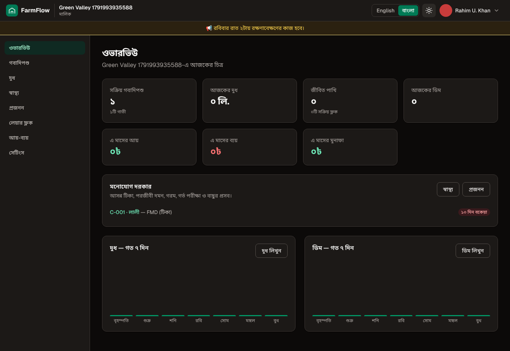
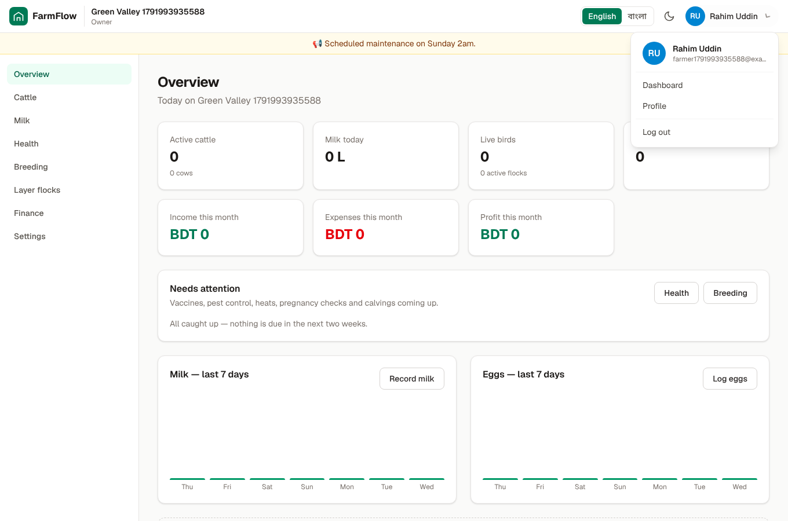
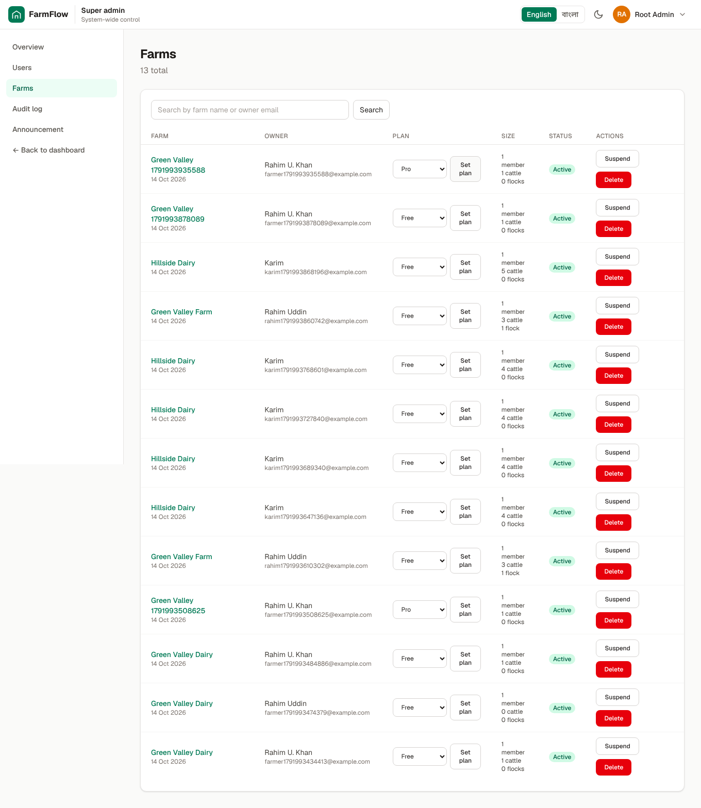
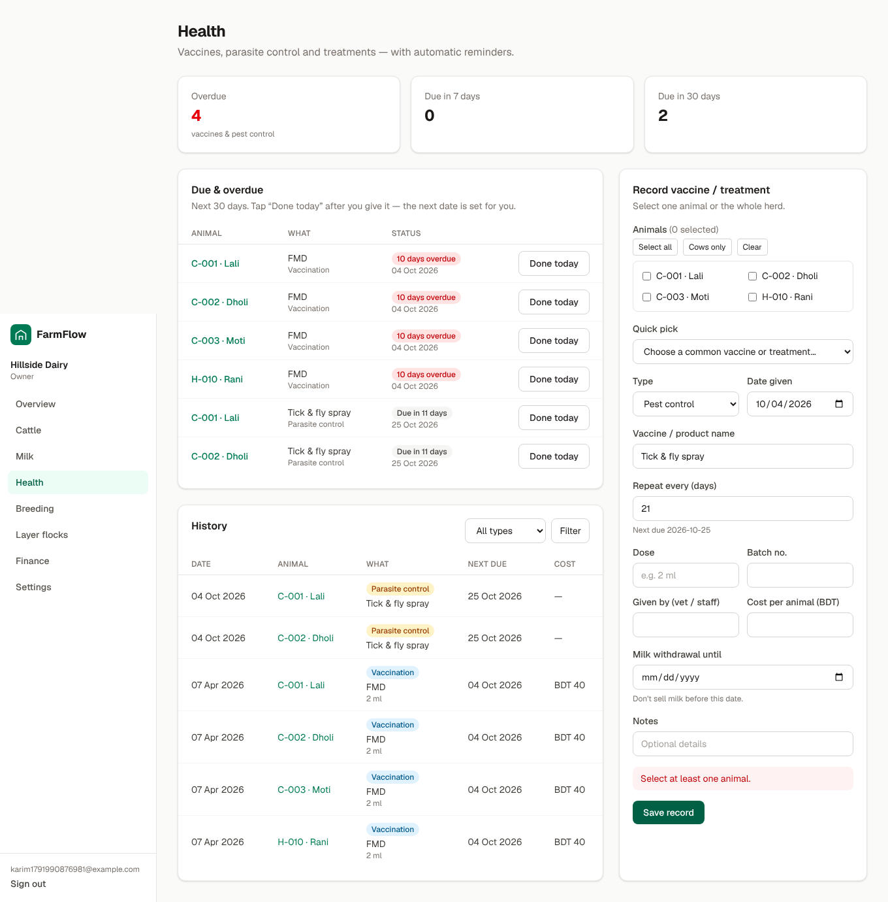
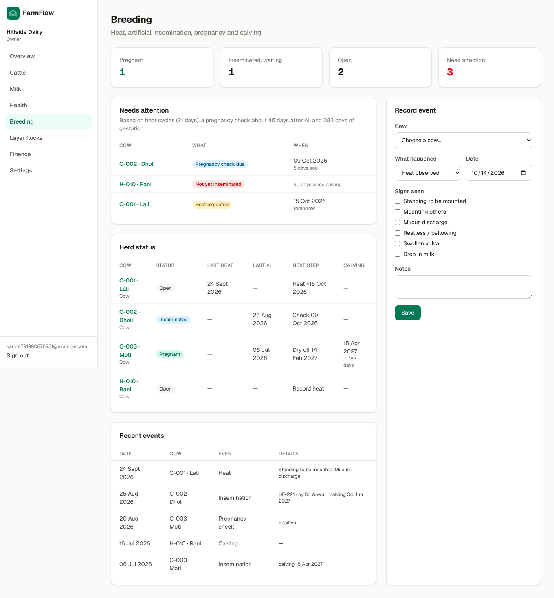

# FarmFlows — Cattle, Dairy & Layer Farm Management (SaaS)

A multi-tenant farm management web app built with **Next.js 16 (App Router)** and **Supabase**.

| Overview (Bangla, dark) | Avatar menu, language & theme | Super admin: farms |
| --- | --- | --- |
|  |  |  |

| Health & reminders | Breeding & heat |
| --- | --- |
|  |  |

## Features

- **Accounts & farms**: email sign-up/login, farm onboarding, one owner per farm, and a team roles model (owner / manager / worker / vet).
- **Cattle register**: tag, name, breed, category, age, status, purchase info, search and filter. Record each animal's **mother** (dropdown of the farm's females, shown with their type, or "Unknown") and **father** (free text); the animal page shows a *Family* card with parents and calves.
- **Weight history** (each animal's page): add weights from a scale, a measuring tape (heart girth × body length → kg by Schaeffer's formula, worked out as you type and again on the server) or an estimate. Shows current weight, change since last, daily gain (kg/day), total gain and a line chart; the cattle list shows each animal's current weight.
- **Breed dropdowns**: cattle and flock breed are admin-managed dropdowns (Local, Holstein Friesian, Jersey, Sahiwal, … / ISA Brown, Lohmann, Hy-Line, …). Older free-text breeds keep showing.
- **Plans & limits** (Free / Pro / Business, shown live on the home page from the `plans` table). Limits are enforced by database triggers, so stale pages and the future mobile app cannot bypass them: Free allows 25 cattle. Users get a warning at 80 %, and at the limit the add form is replaced with an upgrade prompt.
  - *Upgrade requests*: `/dashboard/plan` creates a request; a super admin approves it in *Admin → Requests* after the manual bKash/Nagad payment (instructions text is editable in *Admin → Plans*). No payment gateway is integrated yet.
  - *Pro / Business*: more cattle, flocks and team seats, **CSV reports** (`/dashboard/reports`, blocked with 403 on Free). *Business*: **multiple farms** with a farm switcher, and a priority support inbox.
- **Doctors (veterinarians)**: sign up at `/doctor/signup`, fill in a profile (specialty, licence, area), and a super admin verifies them. Farm owners invite doctors by email; a doctor accepts at `/invites` and sees all their farms in `/doctor`. Vets can read everything except finances and write only health and breeding records. Vets do not use team seats.
- **Archive / delete an animal**: *Archive* hides an animal from lists and pickers but keeps every record; it stops counting toward the plan limit and can be restored (restoring is blocked while the farm is at its limit). *Delete* permanently removes the animal with its milk, health and breeding records (owners and managers only, with a confirmation; calves just lose their mother link).
- **Edit health and breeding records**: every row has an *Edit* link. Editing a health record recalculates its next due date; the type of a breeding event is fixed. Vets can edit health and breeding records too.
- **Milk**: a milking sheet that records every cow for one session at once (morning/evening), with fat %, daily totals, and per-cow history.
- **Health** (`/dashboard/health`): vaccines, pest/parasite control (tick & fly spray, pour-on), deworming and treatments.
  - Record for **one animal or the whole herd at once**, with quick-pick presets (FMD, HS, BQ, Anthrax, LSD, Rabies, Brucellosis, deworming, tick spray) that fill in the usual repeat interval.
  - Every product gets a **next due date**. The *Due & overdue* board lists what is late or due in 30 days, and **Done today** repeats it and schedules the next one.
  - Dose, batch number, who gave it, cost, and **milk withdrawal period** warnings.
- **Breeding** (`/dashboard/breeding`): heat tracking, artificial insemination, pregnancy checks, calving, dry-off.
  - Every event can carry an optional **time of day** (with a "Now" button); it is shown under the date, can be edited, and is included in the CSV export.
  - Heat is recorded with the signs seen; the **next heat is predicted** (21-day cycle) and flagged ±3 days around it.
  - AI records bull/semen, technician and cost; expected calving is set at **283 days**; a **pregnancy check is due ~45 days** after AI, and **return-to-heat** is watched at day 21.
  - Each cow shows as **Open / Inseminated / Pregnant**, with dry-off date (60 days before calving) and cows **not yet served 60+ days after calving** flagged.
  - Recording a calving can **register the calf** in the herd (linked to its mother) and promotes a heifer to cow.
- **Reminders**: the Overview page shows everything overdue or coming up in one *Needs attention* list.
- **Bangla & English**: every page, form, message, date and number (Bangla digits and month names) is translated. Switch language from the top bar; the choice is remembered, and first-time visitors get Bangla if their browser prefers it.
- **Feedback**: toast pop-ups confirm every add / update / delete (and show errors on row actions), buttons show a spinner while saving, and the sidebar links and pages show a loader while data loads.
- **Mobile friendly**: the sidebar becomes a slide-in menu, tables keep one row per record and scroll sideways on phones (first column pinned), forms use 16px fields (no iOS zoom) and bigger tap targets, and nothing scrolls sideways from 320px up. Checked on every page in English and Bangla.
- **Installable app (PWA)**: add FarmFlows to the home screen of an Android or iPhone and it opens full-screen with its own icon and shortcuts (Milk, Cattle, Health). An *Install* banner appears when the browser supports it (on iPhone it explains Share → Add to Home Screen). A service worker caches only build assets and icons; pages and data are never cached, and a bilingual "no connection" page shows when offline. It works over HTTPS (any deployment, e.g. Vercel).
- **Blog** (`/blog`): public articles in Bangla and English, with a first article on how to organise cattle tag numbers. Super admins write, edit, publish / unpublish and delete articles in *Admin → Blog* (Markdown with headings, lists, tables and links; drafts are only visible to admins; every change is in the audit log). Writes go through `admin_*` database functions, so only super admins can change posts.
- **AI assistant** (chat button on every dashboard page for owners, managers and workers): farmers type or speak (Bangla or English) what happened, e.g. "today 001 gave 6 litres" or "gave FMD to 002", and the AI prepares the record (milk, vaccine/treatment, breeding event, new animal, flock log, income/expense). **Nothing is saved until the farmer presses Confirm**, and then the same server action as the normal form runs, so every rule (plan limits, permissions, duplicate tags) still applies.
  - **Switchable AI service** (*Admin → AI assistant*): **Claude** (default `claude-haiku-5-5`, the cheapest), **Gemini** (default `gemini-3.8-flash`, has a free tier, good for testing) or any **custom OpenAI-compatible** service (Groq, OpenRouter, Ollama). Pick the service and model there (blank model = default) and press *Test connection*. API keys are never stored in the database: set `ANTHROPIC_API_KEY`, `GEMINI_API_KEY` or `AI_API_KEY` as server environment variables; the admin page only shows whether a key exists.
  - **Monthly prompt limits** per farm per calendar month (Asia/Dhaka), enforced in the database: **Free 5, Pro 50, Business 150**, editable per plan in *Admin → Plans* (empty = unlimited, 0 = off). A prompt that fails because of the AI service is refunded; confirming a record costs nothing.
- **Doctor entries need the owner's approval**: when a vet adds or edits a health or breeding record (or presses "Done today"), nothing is saved yet. The entry goes to *Approvals*, where the farm owner or a manager sees exactly what was entered and who sent it, and approves it (it is then saved through the normal action, with the doctor's name on the record) or rejects it with a reason. The vet sees the status, can withdraw a waiting entry, and a banner and a count in the menu tell the owner when something is waiting. Enforced in the database: vets have no write access to health or breeding tables, only to submit entries.
- **Dark & light mode**: toggle in the top bar, remembered per device, no flash on load.
- **Left sidebar** (a slide-in menu on phones) holds the navigation; the **top bar** has language and theme toggles beside the profile picture; the avatar opens *Dashboard / Profile / Admin panel (super admins) / Log out*.
- **Profile** (`/dashboard/profile`): upload a profile photo (cropped to a square, stored in Supabase Storage), edit name and phone, change password.
- **Super admin panel** (`/admin`, see below).
- **Layer flocks**: batches with breed, shed and age. Daily logs cover eggs, broken eggs, deaths, culls, feed and water.
  KPIs: live birds, **hen-day production %**, mortality %, feed per dozen eggs, grams of feed per bird.
- **Finance** (`/dashboard/finance`): one ledger for all money. Manual income/expenses plus costs recorded elsewhere appear automatically (cow medicine, breeding/AI cost, layer flock health cost, staff salary payments), tagged by source; tap one to edit it at its source. Switch *Whole farm / Cow farm / Layer farm* (farms with both) with correct totals and profit, plus a by-category breakdown. The overview and CSV export include the same rows (database view `finance_ledger`).
- **Staff & salary** (`/dashboard/staff`, owners and managers only): workers need no login. Monthly salary, attendance that is automatic — everyone counts as present and you only mark absences, leave or half days, advances, bonuses and salary payments; absences are deducted per day and the balance is shown. Payments flow into finance as *Labour*.
- **Layer flock health** (`/dashboard/flock-health`): vaccines (Newcastle, Gumboro, …), deworming, lice/mite spray and medicine per flock, with admin-editable quick picks, due/overdue board, egg-withdrawal dates and costs.
- **Dedicated add pages & clickable rows**: add cattle, milk, health, breeding, flocks, daily logs, flock health, staff and transactions on their own pages; every table row opens its record.
- **Grouped sidebar**: Cow farm / Layer farm / Money / Farm.
- **Velora UI** (`src/components/velora`, registry `@velora` in `components.json`): aurora hero, rotating words, blur-fade entrances, spotlight feature cards, shimmer buttons, marquee, scroll-progress bar, velora loaders on every page load and in the AI assistant, and a footer with a hover-lit FarmFlows wordmark above an animated farm landscape (barn, windmill, cows, hens, crop rows). All animations respect "reduce motion".
- **Contact, Terms, Privacy** (`/contact`, `/terms`, `/privacy`): super admins edit the contact email, phone, WhatsApp, address, office hours and both legal pages (Bangla + English, Markdown) in *Admin → Pages & contact*. Contact-form messages arrive in *Admin → Messages* (honeypot + flood guard against spam). The legal text is a starter draft — have it checked by a lawyer.
- **Customer reviews**: farm users write a 1–5 star review from *Write a review* in the dashboard; it appears on the home page (velora testimonials marquee) only after a super admin approves it in *Admin → Reviews*. Editing a review sends it back for approval.
- **Home globe**: a velora globe centred on Bangladesh with routes from Dhaka, beside live platform numbers (farms, animals & birds, records) once there are 10+ farms.
- **Breeding rules** (Admin → Announcement & settings): gestation (calving) days, heat cycle, pregnancy check, dry-off and waiting period are editable and used everywhere.
- **Overview dashboard**: today's milk and eggs, herd and flock size, this month's P&L, and 7-day charts.

## Super admin

A super admin controls the whole system from `/admin` (only they can open it; everyone else gets a 404):

| Page | What you can do |
| --- | --- |
| Overview | Users, farms, active cattle/flocks, 30-day milk and eggs, farms per plan |
| Users | Search; **suspend / restore** (signs them out immediately), **make / remove super admin**, delete |
| Farms | Search; change **plan**, **suspend / restore** a farm (its members are locked out), delete a farm and all its data; open a farm's summary |
| Plans | Edit plan prices, limits and payment instructions |
| Requests | Approve / reject upgrade and support requests |
| Blog | Write, edit, publish and delete public blog articles (Bangla + English) |
| Dropdowns | Every dropdown in the app (see below) |
| Audit log | Every admin action: who, what, when |
| Announcement | A banner shown at the top of every user's dashboard (English + Bangla), the payment instructions, and the **breeding rules** (pregnancy check due N days after AI, default 45) |

### Dropdowns

All 17 dropdowns are stored in the database (`dropdown_options`), so web and mobile share them. In *Admin → Dropdowns* a super admin can rename options in English and Bangla, reorder them and hide them:

- **Fully editable** (add new options too): animal type, income & expense categories, vaccine/treatment quick picks, heat signs, currencies.
- **Fixed** (rename and reorder only, because the app's logic relies on the values): animal/flock status, milking session, health record type, breeding event, pregnancy result, transaction type and module.

Options are never deleted: a hidden option disappears from forms, but older records keep showing its name.

**Animal type sets the sex.** By default the types are Cow (গাভী) and Heifer (বকনা), which are female, and Bull (ষাঁড়), which is male. There is no separate sex field. Each type has a *sex* and a *milking animal* setting; milking types appear on the milking sheet.

**Create your first super admin** (a normal user must sign up first), in the Supabase SQL editor:

```sql
select public.grant_super_admin('you@example.com');
```

After that, make more admins from *Admin → Users*. Safety rules enforced in the database, not just the UI:

- Users can never promote themselves or change their own plan / suspension — those columns are not writable by normal users.
- Every `admin_*` function re-checks `is_super_admin()`; an admin cannot suspend, delete or demote their own account.
- A user who owns farms can't be deleted until the farms are removed; every admin action is written to the audit log.

## Architecture

```
Next.js (web)  ─┐
                ├──►  Supabase  (Postgres + RLS, Auth, Storage)
Mobile app     ─┘     (later: same database, same rules)
```

- **Security lives in the database.** Every table has a `farm_id`, and Postgres
  **Row Level Security** only lets users touch rows of farms they are a
  member of. A future mobile app (React Native / Expo or Flutter) can use
  the Supabase client directly and gets the same protection, with no extra backend.
- Composite foreign keys (`(cattle_id, farm_id)`, `(flock_id, farm_id)`) make it
  impossible to attach a record to another farm's animal.
- `create_farm()` RPC creates a farm and its owner membership atomically.
- `flock_stats` view (security-invoker) computes live bird counts.
- All tables use UUIDs plus `created_at` / `updated_at` (and `deleted_at` where relevant),
  ready for offline sync in the mobile app.

```
supabase/migrations/   SQL schema, RLS policies, functions, admin_* functions, storage bucket
src/proxy.ts           refreshes the Supabase session, protects /dashboard
src/lib/supabase/      browser / server / proxy clients
src/lib/auth.ts        requireUser() / requireFarm() data access layer
src/app/(auth)/        login & signup
src/app/onboarding/    create the first farm
src/app/dashboard/     overview, cattle, milk, health, breeding, flocks, finance, settings, profile
src/app/admin/         super admin panel
src/lib/i18n/          English + Bangla dictionaries (typed: a missing Bangla key fails the build)
```

## Getting started

### 1. Install

```bash
npm install
cp .env.example .env.local
```

### 2a. Use a hosted Supabase project

1. Create a project at [supabase.com](https://supabase.com).
2. Run the migration: either paste `supabase/migrations/*.sql` into the SQL editor, or
   ```bash
   npx supabase login
   npx supabase link --project-ref <your-project-ref>
   npx supabase db push
   ```
3. Put the project URL and publishable (anon) key into `.env.local`.
4. In **Authentication → URL Configuration**, set the Site URL and add
   `https://your-domain/auth/confirm` to the redirect URLs.

### 2b. Or run Supabase locally (requires Docker)

```bash
npm run db:start      # prints the API URL and publishable key for .env.local
```

Profile photos use Supabase Storage, which `db:start` includes. If you start Supabase with
services excluded (`-x`), keep `storage-api` running.

### 3. Run

```bash
npm run dev           # http://localhost:3000
```

Sign up, create your farm, then add cattle and flocks.

### Useful scripts

| Script | What it does |
| --- | --- |
| `npm run dev` / `build` / `start` | Next.js |
| `npm run lint` / `typecheck` | ESLint / TypeScript |
| `npm run db:start` / `db:stop` | Local Supabase |
| `npm run db:reset` | Recreate the local database from migrations |
| `npm run db:types` | Generate TypeScript types from the database |

## Deploy

- **Web:** Vercel (set the three `NEXT_PUBLIC_*` env vars). `NEXT_PUBLIC_SITE_URL` must be the real address (e.g. `https://farmflows.app`): the sitemap, robots.txt, share image links and email links use it.
- **Database:** Supabase cloud (`npx supabase db push`).

### SEO

`/sitemap.xml` (home, blog, every published article, sign-up pages — refreshed hourly), `/robots.txt` (private areas `/dashboard`, `/admin`, `/doctor`, `/api` … are disallowed and also marked `noindex`), a share image (`/opengraph-image`), Open Graph / Twitter tags, canonical URLs, and schema.org JSON-LD (Organization + SoftwareApplication on the home page, BlogPosting on articles). After deploying, add the site in Google Search Console and submit `https://<your-domain>/sitemap.xml`.

### Analytics, IP and location

Super admin → **Analytics**: page views, visitors, sign-ups, active users, logins, new farms, daily charts, top pages, referrers, countries, devices, a globe of where users are, and the last 20 sign-ins with IP and approximate location. The users list shows each user's last IP and city. Everything is first-party (tables `page_views`, `login_events`, `user_presence`; readable only by super admins). Location comes from the hosting edge's headers, so it works automatically on **Vercel** (`x-vercel-ip-*`) or **Cloudflare** (turn on *Add visitor location headers*); when running locally there is no location. Anonymous visits are counted without IP addresses; mention IP collection in your privacy policy.

### Branded account emails (instead of "Supabase Auth")

By default Supabase sends sign-up emails from its own address with its own text, and only a few per hour. To send them as **FarmFlows** from your domain:

1. **Get an SMTP sender**, e.g. [Resend](https://resend.com) (free 3,000 emails/month), Brevo or Amazon SES. Add and verify your domain there (DNS records) and create an SMTP password / API key.
2. Supabase Dashboard → **Project Settings → Authentication → SMTP Settings** → *Enable custom SMTP*:
   sender email `noreply@your-domain`, sender name `FarmFlows`, host/port/user/password from step 1 (Resend: `smtp.resend.com`, port `465`, user `resend`, password = API key).
3. **Authentication → Email Templates**: paste the files from `supabase/templates/` (`confirmation.html` → *Confirm signup*, `recovery.html` → *Reset password*, `magic_link.html`, `email_change.html`, `invite.html`) and the subjects from `supabase/config.toml`. They are bilingual (Bangla + English), use the FarmFlows logo and link to `/auth/confirm` on your site.
4. **Authentication → URL Configuration**: *Site URL* = your domain, and add `https://<your-domain>/auth/confirm` to *Redirect URLs*.
5. Optionally raise **Rate limits → emails per hour** (custom SMTP allows more).

Locally, `npx supabase start` already uses these templates (see Inbucket at http://localhost:54324).

### Speed

Dropdown options and plans (read on every page) are cached across visitors and refreshed the moment a super admin edits them; the AI chat and the globe load only after the page; fonts are self-hosted; logos/icons are cached by the browser; motion code is tree-shaken.

## Roadmap

- More languages (the dictionaries make this a one-file addition)
- Team invitations (email invite → `farm_members`)
- Subscription billing (Stripe / SSLCommerz / bKash) and plan limits
- Feed & medicine inventory, egg/milk sales to customers with invoices
- Reports & CSV/PDF export; SMS / WhatsApp / push reminders for vaccines, heats and calvings
- Mobile app (Expo + Supabase, offline-first) in a monorepo
