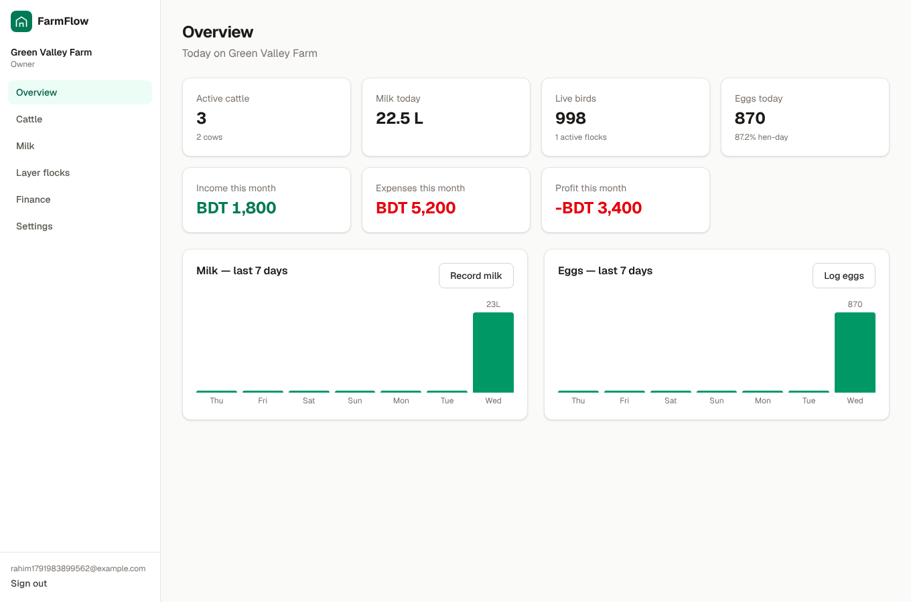
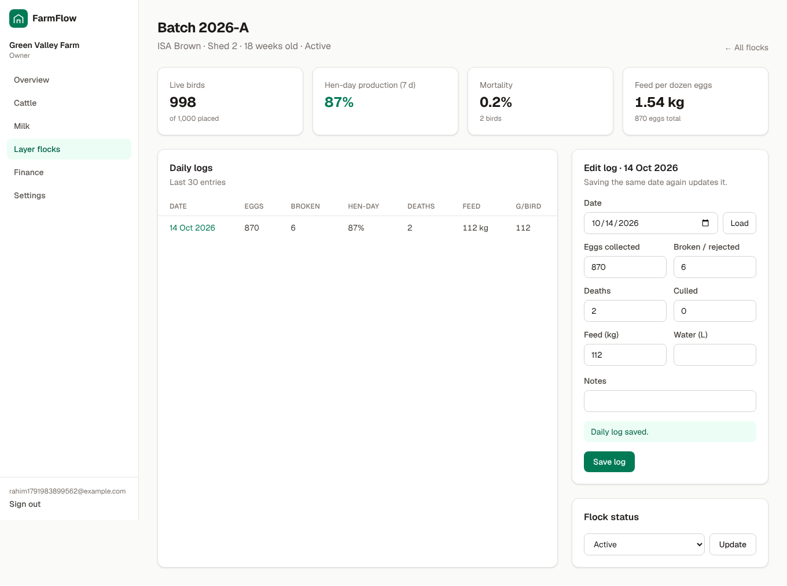
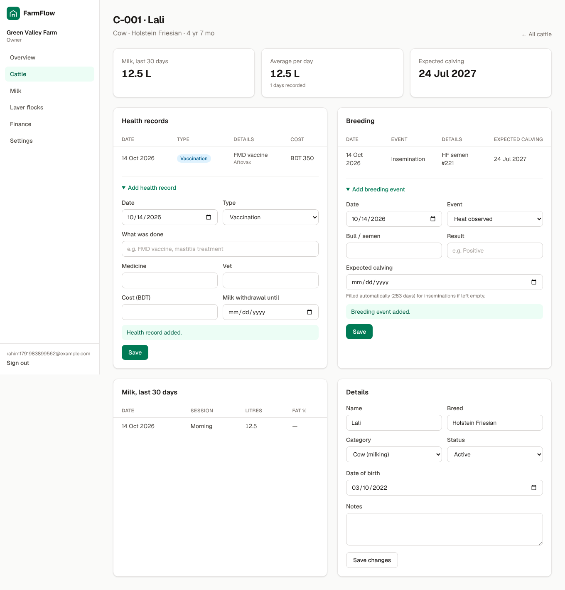

# FarmFlow — Cattle, Dairy & Layer Farm Management (SaaS)

A multi-tenant farm management web app built with **Next.js 16 (App Router)** and **Supabase**.

| Overview | Layer flock | Cow record |
| --- | --- | --- |
|  |  |  |

## Features

- **Accounts & farms**: email sign-up/login, farm onboarding, one owner per farm, and a team roles model (owner / manager / worker / vet).
- **Cattle register**: tag, name, breed, category, age, status, purchase info, search and filter.
- **Milk**: a milking sheet that records every cow for one session at once (morning/evening), with fat %, daily totals, and per-cow history.
- **Health**: vaccinations, treatments, deworming and costs. The cow's page warns about **milk withdrawal periods**.
- **Breeding**: heat, AI, pregnancy checks, calving. The expected calving date is auto-calculated (283 days).
- **Layer flocks**: batches with breed, shed and age. Daily logs cover eggs, broken eggs, deaths, culls, feed and water.
  KPIs: live birds, **hen-day production %**, mortality %, feed per dozen eggs, grams of feed per bird.
- **Finance**: income and expenses by category and module (dairy / layer / general), with monthly profit.
- **Overview dashboard**: today's milk and eggs, herd and flock size, this month's P&L, and 7-day charts.

## Architecture

```
Next.js (web)  ─┐
                ├──►  Supabase  (Postgres + RLS, Auth, Storage)
Mobile app     ─┘     (later: same database, same rules)
```

- **Security lives in the database.** Every table has a `farm_id`, and Postgres
  **Row Level Security** only lets users touch rows of farms they are a
  member of. A future mobile app (React Native / Expo or Flutter) can use
  the Supabase client directly and gets the same protection, with no extra backend.
- Composite foreign keys (`(cattle_id, farm_id)`, `(flock_id, farm_id)`) make it
  impossible to attach a record to another farm's animal.
- `create_farm()` RPC creates a farm and its owner membership atomically.
- `flock_stats` view (security-invoker) computes live bird counts.
- All tables use UUIDs plus `created_at` / `updated_at` (and `deleted_at` where relevant),
  ready for offline sync in the mobile app.

```
supabase/migrations/   SQL schema, RLS policies, functions
src/proxy.ts           refreshes the Supabase session, protects /dashboard
src/lib/supabase/      browser / server / proxy clients
src/lib/auth.ts        requireUser() / requireFarm() data access layer
src/app/(auth)/        login & signup
src/app/onboarding/    create the first farm
src/app/dashboard/     overview, cattle, milk, flocks, finance, settings
```

## Getting started

### 1. Install

```bash
npm install
cp .env.example .env.local
```

### 2a. Use a hosted Supabase project

1. Create a project at [supabase.com](https://supabase.com).
2. Run the migration: either paste `supabase/migrations/*.sql` into the SQL editor, or
   ```bash
   npx supabase login
   npx supabase link --project-ref <your-project-ref>
   npx supabase db push
   ```
3. Put the project URL and publishable (anon) key into `.env.local`.
4. In **Authentication → URL Configuration**, set the Site URL and add
   `https://your-domain/auth/confirm` to the redirect URLs.

### 2b. Or run Supabase locally (requires Docker)

```bash
npm run db:start      # prints the API URL and publishable key for .env.local
```

### 3. Run

```bash
npm run dev           # http://localhost:3000
```

Sign up, create your farm, then add cattle and flocks.

### Useful scripts

| Script | What it does |
| --- | --- |
| `npm run dev` / `build` / `start` | Next.js |
| `npm run lint` / `typecheck` | ESLint / TypeScript |
| `npm run db:start` / `db:stop` | Local Supabase |
| `npm run db:reset` | Recreate the local database from migrations |
| `npm run db:types` | Generate TypeScript types from the database |

## Deploy

- **Web:** Vercel (set the three `NEXT_PUBLIC_*` env vars).
- **Database:** Supabase cloud (`npx supabase db push`).

## Roadmap

- Team invitations (email invite → `farm_members`)
- Subscription billing (Stripe / SSLCommerz / bKash) and plan limits
- Feed & medicine inventory, egg/milk sales to customers with invoices
- Reports & CSV/PDF export, reminders (vaccination, expected calving)
- Bangla language (i18n)
- Mobile app (Expo + Supabase, offline-first) in a monorepo
