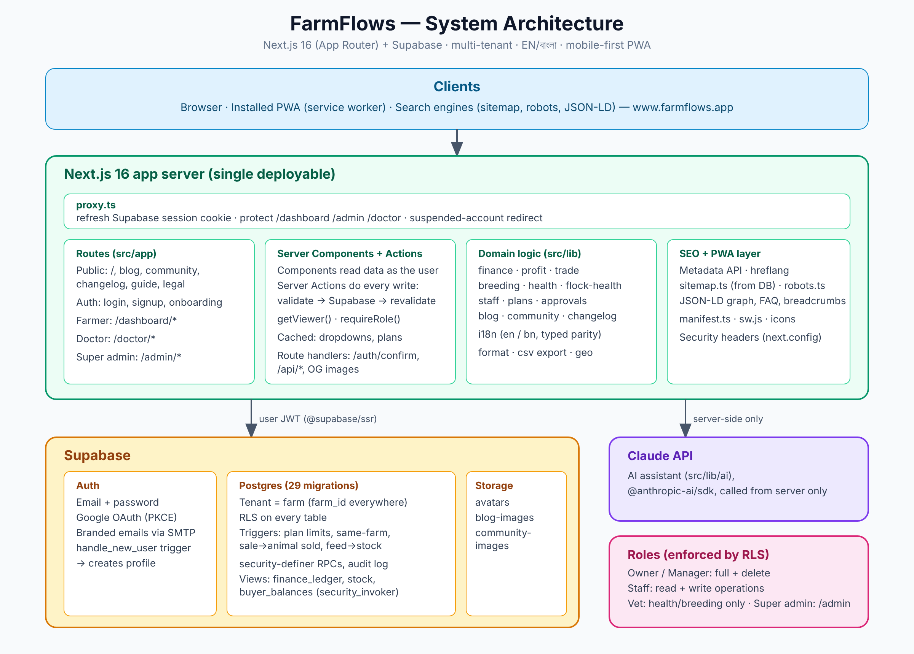

# FarmFlows — System Architecture

Multi-tenant dairy/cattle and layer-poultry farm SaaS. Next.js 16 (App Router, React 19) on top of Supabase (Auth, Postgres, Storage). English and Bangla, mobile-first PWA.

(Editable source: `architecture.svg`.)

## 1. Overview

There is no separate backend. Next.js is the only app server and Postgres enforces the security rules.

- **Reads:** Server Components query Supabase as the logged-in user.
- **Writes:** every write is a Server Action: validate, call Supabase (table write or RPC), revalidate paths.
- **Authorization:** the browser never holds a service key. Queries carry the user's JWT, so Row Level Security decides access.
- **AI:** the Claude API is called from server code only (`src/lib/ai`).
- **Email:** branded auth emails go out through Supabase with an SMTP provider.

## 2. Layers

| Layer | Responsibility | Location |
|---|---|---|
| Routing and UI | Public, auth, farmer, doctor and super-admin areas | `src/app` |
| Components | Forms, avatar, header/footer, markdown, community widgets | `src/components` |
| Domain logic | Pure helpers per area (finance, profit, trade, breeding, health, staff, plans…) | `src/lib/*.ts` |
| Data access | Server/browser Supabase clients, `getViewer()`, `requireRole()` | `src/lib/supabase`, `src/lib/auth.ts` |
| i18n | `en` and `bn` messages (bn type-checked against en), formatters | `src/lib/i18n` |
| Database | Ordered migrations | `supabase/migrations` |
| Edge of the app | `src/proxy.ts`: session refresh, route protection, suspended-account redirect | `src/proxy.ts` |

## 3. Data model

The tenant is the **farm**; almost every table carries `farm_id`.

- **Identity and tenancy:** profiles (farmer / doctor / super admin), farms, farm members (owner, manager, staff, vet), invites, plans and limits, upgrade requests.
- **Cattle and dairy:** cattle, parents, weights, milk records, health with due dates, breeding (heat, AI, pregnancy, calving).
- **Layer poultry:** flocks, daily logs (eggs, mortality, feed), flock health.
- **Money:** `finance_ledger` view merges expenses, medicine, breeding, flock health, salary, stock purchases and sales. `farm_monthly_summary()` feeds the profit page.
- **Trade:** inventory items and moves, `inventory_stock` view, buyers, sales, buyer payments, `buyer_balances` view.
- **Staff:** salary, attendance, payments.
- **Platform:** admin-managed dropdown lists, audit log, presence (approximate location), suspension.
- **Content:** blog (posts, categories, tags, media) and community (topics, questions, answers, votes, reports, bans).

Rules live in the database:

- RLS on every table.
- Plan limits via triggers (`PLAN_LIMIT:*`).
- `security definer` functions: `admin_assert`, `admin_log`, `is_super_admin`, `has_farm_role`, `is_farm_member`.
- Views use `security_invoker` so they obey the caller's RLS.
- Triggers: same-farm checks, sale marks animal sold, flock feed use deducts stock, `handle_new_user` creates the profile (taking name and photo from Google).

## 4. Roles

| Role | Access |
|---|---|
| Owner / manager | Full farm access, including deletes |
| Staff | Read and write operational data |
| Vet (doctor) | Invited to a farm; health and breeding only, no finance, stock or sales |
| Super admin | `/admin`: users, plans, dropdown options, blog, community moderation, analytics; actions are audit-logged |

## 5. Request flow

1. `proxy.ts` refreshes the Supabase cookie session and gates protected routes.
2. A Server Component calls `getViewer()` / `requireRole(...)`, queries Postgres as the user, renders HTML. Rarely changing data (dropdown options, plans) is cached.
3. A form posts to a Server Action, which validates, writes through Supabase, then revalidates affected paths.
4. Google sign-in and email links return to `/auth/confirm`, which exchanges the code for a session and fills an empty profile name/photo from Google.

## 6. Cross-cutting

- **SEO:** metadata API, DB-driven `sitemap.ts`, `robots.ts`, JSON-LD (WebSite, Organization, SoftwareApplication, FAQ, Breadcrumb), hreflang, dynamic OG images.
- **PWA:** `manifest.ts`, `public/sw.js`, icon set (48 to 512 px).
- **Security:** headers in `next.config.ts`, route protection in `proxy.ts`, RLS as the last line of defence.
- **Testing:** Playwright browser scripts and SQL rule tests against local Supabase (Docker). No unit-test framework.

## 7. Deployment

Next.js app on a Next.js-compatible host; Supabase as managed backend. Database changes ship with `npx supabase db push`; app changes ship by merging to `main`.
